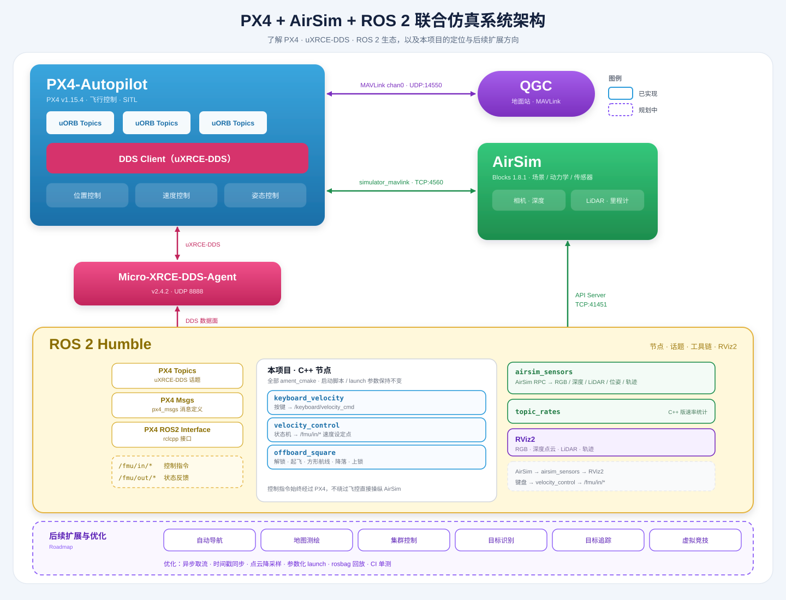
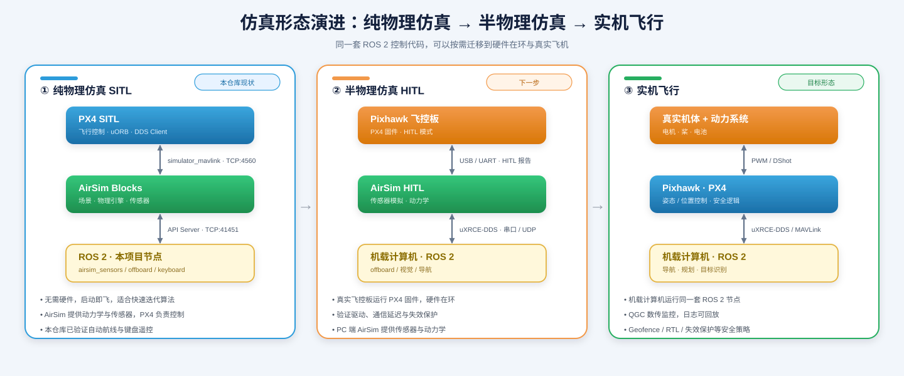

# PX4 + AirSim + ROS 2 联合仿真

这是一个运行在 **Windows 11 + WSL2** 上的无人机联合仿真项目。它把 AirSim 的场景与传感器、PX4 的飞行控制和 ROS 2 的控制/可视化连接起来，适合用于：

- 学习 PX4 Offboard 控制流程；
- 在无真实无人机的情况下验证 ROS 2 控制节点；
- 获取仿真的 RGB、深度、LiDAR、里程计和飞行轨迹；
- 用自动航线或键盘控制无人机，并在 RViz2 中观察结果。

项目已经完成端到端联调。默认示例可以自动完成解锁、起飞、方形航线、降落和上锁，也可以切换为键盘遥控。

## 系统架构与生态



这张图把本项目放回 PX4 的完整生态中：

- **飞控层（PX4-Autopilot）**：uORB 消息在飞控模块之间流转，`DDS Client` 通过 `Micro-XRCE-DDS-Agent` 把 `/fmu/in/*`、`/fmu/out/*` 暴露给 ROS 2；QGC 通过 MAVLink（UDP 14550）连接。
- **仿真层（AirSim Blocks）**：在 Windows 侧提供场景、物理引擎与传感器，通过 `simulator_mavlink`（TCP 4560）与 PX4 交换状态和控制，通过 `API Server`（TCP 41451）向 ROS 2 提供图像、深度、LiDAR 和位姿。
- **中间件（uXRCE-DDS）**：PX4 与 ROS 2 之间不使用 MAVLink，而是直接通过 DDS 话题通信，ROS 2 侧的消息定义由 `px4_msgs` 提供。
- **应用层（ROS 2）**：本仓库提供 `airsim_sensors`、`topic_rates`、`keyboard_velocity`、`velocity_control`、`offboard_square` 五个 C++ 节点，全部是 `ament_cmake` 包；RViz2 负责可视化。


## 仿真形态：纯物理 / 半物理 / 实机



| 形态 | 仿真对象 | 硬件 | 典型用途 |
| --- | --- | --- | --- |
| 纯物理仿真 SITL | 飞机动力学、传感器 | 无 | 算法快速迭代、CI |
| 半物理仿真 HITL | 传感器与外部环境 | 真实飞控板 | 验证固件配置、驱动与通信延迟 |
| 实机飞行 | 真实飞机 | 飞控 + 机载计算机 | 外场验证与任务执行 |

本仓库当前处于 SITL 阶段。后续迁移时，`airsim_sensors`、`velocity_control`、`offboard_square` 等节点可以保持接口不变，只替换数据来源与运行载体。

## 后续可以做的优化

- **桥接性能**：RPC 取流改为异步流水线，按消息时间戳做时间同步，点云降采样后再发布。
- **控制能力**：从速度控制扩展到位置、姿态控制与轨迹跟踪，逐步引入避障。
- **仿真能力**：支持 HITL 半物理仿真、LockStep 性能优化、多机集群与 AirSim 多机场景。
- **工程质量**：为节点补充单元测试与 CI，参数统一走 launch/YAML，支持 rosbag 录包与回放。
- **可视化**：在 RViz2 之外接入 Foxglove Studio，方便远程查看话题与 TF。
- **上层应用**：自动导航、地图测绘、集群控制、目标识别、目标追踪、虚拟竞技，对应图中的虚线模块。

## 系统如何工作

AirSim 负责仿真环境、动力学和传感器，PX4 负责飞行控制。ROS 2 通过 PX4 的 `/fmu/in/*` 话题发送控制指令，通过 AirSim RPC 获取传感器和位姿数据。控制指令不会绕过 PX4 直接操纵 AirSim。

## 运行环境

当前脚本按以下环境编写：

| 组件 | 版本或位置 |
| --- | --- |
| Windows / WSL | Windows 11、WSL2 mirrored 网络 |
| Linux | Ubuntu 22.04 |
| ROS 2 | Humble，安装在 `/opt/ros/humble` |
| AirSim | 1.8.1 Blocks，安装在 `D:\AirSim\Blocks` |
| PX4 | v1.15.4，位于 `px4/PX4-Autopilot` |
| Micro-XRCE-DDS-Agent | v2.4.2，位于 `third_party/Micro-XRCE-DDS-Agent` |

首次运行前，还需要把 [airsim/settings.json](airsim/settings.json) 放到 Windows 用户的 AirSim 配置目录：

```bash
cp airsim/settings.json /mnt/c/Users/<Windows用户名>/Documents/AirSim/settings.json
```

如果 AirSim 或工程安装在其他位置，需要先修改 [scripts/common.sh](scripts/common.sh) 中的 `BLOCKS_EXE`、`BLOCKS_DIR`、`ROS_SETUP` 等路径。

## 快速开始

在 WSL2 终端进入项目目录：

```bash
cd /home/ppl22/pp_proj/px4_airsim_sim
```

按下面的顺序启动各组件：

```bash
./scripts/start_agent.sh    # 1. 启动 PX4 与 ROS 2 之间的 DDS Agent
./scripts/start_blocks.sh   # 2. 在 Windows 启动 AirSim Blocks
./scripts/start_px4.sh      # 3. 启动 PX4 SITL 并连接 AirSim
./scripts/start_bridge.sh   # 4. 发布 AirSim 传感器和位姿话题
./scripts/start_rviz.sh     # 5. 打开 RViz2
```

每条命令成功后再执行下一条。启动完成后，从下面两种控制方式中选择一种。

### 自动方形航线

```bash
./scripts/start_offboard.sh
```

该命令在前台运行，默认飞行高度为 2.5 m、方形边长为 5 m。无人机会自动解锁、进入 Offboard、完成航线、降落并上锁。按 `Ctrl+C` 可中止程序。

可以在启动时修改航线参数：

```bash
./scripts/start_offboard.sh altitude:=2.0 square_size:=3.0 leg_seconds:=6.0
```

| 参数 | 默认值 | 含义 |
| --- | ---: | --- |
| `altitude` | 2.5 | 飞行高度，单位 m |
| `square_size` | 5.0 | 方形边长，单位 m |
| `leg_seconds` | 8.0 | 每条边的飞行时间，单位 s |
| `offboard_hold_seconds` | 2.0 | 切入 Offboard 前的设定点预发送时间 |
| `land_timeout` | 90.0 | 等待降落完成的超时时间，单位 s |

### 键盘遥控

```bash
./scripts/start_keyboard.sh
```

键盘程序必须在前台运行并保持终端焦点。按 `i` 后无人机将解锁、进入 Offboard，并自动爬升到默认 1.5 m。

| 按键 | 动作 | 按键 | 动作 |
| --- | --- | --- | --- |
| `w` / `s` | 向北 / 向南 | `a` / `d` | 向西 / 向东 |
| `i` / `k` | 上升 / 下降 | `j` / `l` | 左转 / 右转 |
| `h` | 悬停 | `g` | 降落 |
| `q` | 退出 | | |

起飞高度等参数也可以在命令行修改：

```bash
./scripts/start_keyboard.sh takeoff_altitude:=2.0 takeoff_climb_rate:=0.6 cmd_timeout:=0.5
```

自动航线和键盘遥控都会持续发布 Offboard 设定点，因此不能同时运行。启动脚本会自动停止另一种控制程序。

## 检查运行状态

查看进程、AirSim 连接、DDS 端口和 ROS 2 话题：

```bash
./scripts/status.sh
```

正常情况下应看到：

- `MicroXRCEAgent`、`px4` 和 `airsim_sensors` 正在运行；
- AirSim 状态为 `connected`；
- UDP 8888 已监听；
- 存在 `/fmu/*` 和 `/airsim/*` 话题。

测量 AirSim 各话题的实际发布频率：

```bash
./scripts/topic_rates.sh 15
```

RViz2 默认显示 RGB 图像、深度点云、LiDAR 点云和 `Trajectory` 飞行轨迹。主要输出话题如下：

| 话题 | 内容 |
| --- | --- |
| `/airsim/camera/image_raw` | 前视 RGB 图像 |
| `/airsim/depth/image` | 深度图 |
| `/airsim/depth/points` | 深度点云 |
| `/airsim/lidar/points` | LiDAR 点云 |
| `/airsim/odom` | 无人机里程计 |
| `/airsim/path` | 飞行轨迹 |

## 停止与重新启动

停止 WSL2 中的 PX4、ROS 2、RViz2 和 DDS Agent，但保留 Windows 上的 Blocks：

```bash
./scripts/stop_all.sh
```

同时关闭 Blocks：

```bash
./scripts/stop_all.sh --blocks
```

**重新启动 PX4 前必须先关闭并重新启动 Blocks。** AirSim 的 4560 端口一次只接受一个 SITL 连接，旧连接断开后不能直接供新的 PX4 进程复用。

## 修改项目

常见修改位置如下：

| 需求 | 修改位置 |
| --- | --- |
| 修改相机、LiDAR、端口或 PX4 参数 | `airsim/settings.json` |
| 修改传感器发布频率或桥接参数 | `ros2_ws/src/airsim_ros2_bridge/launch/sensors.launch.py` |
| 修改方形航线默认参数 | `ros2_ws/src/px4_offboard_demo/launch/offboard_square.launch.py` |
| 修改键盘控制默认参数 | `ros2_ws/src/px4_keyboard_control/launch/velocity_control.launch.py` |
| 修改启动路径或 Windows Blocks 位置 | `scripts/common.sh` |
| 修改 RViz2 布局 | `ros2_ws/src/airsim_ros2_bridge/config/airsim.rviz` |

修改 `airsim/settings.json` 后，需要重新复制到 Windows 配置目录并重启 Blocks：

```bash
cp airsim/settings.json /mnt/c/Users/<Windows用户名>/Documents/AirSim/settings.json
./scripts/stop_all.sh --blocks
```

修改 ROS 2 源码或 launch 文件后，在工作区重新编译并加载环境：

```bash
cd ros2_ws
source /opt/ros/humble/setup.bash
colcon build --symlink-install
source install/setup.bash
cd ..
```

然后按“快速开始”的顺序重新启动仿真。

## 常见问题

### PX4 一直显示 `Waiting for simulator`

确认 Blocks 已经完全启动，再运行 `start_px4.sh`。不要使用 `Test-NetConnection`、`nc` 或 Python socket 主动探测 4560 端口：探测连接会占用 AirSim 唯一的 SITL 连接。请使用 `./scripts/status.sh` 查看端口状态。

如果 PX4 曾经连接过当前 Blocks，执行：

```bash
./scripts/stop_all.sh --blocks
./scripts/start_agent.sh
./scripts/start_blocks.sh
./scripts/start_px4.sh
```

### RViz2 有窗口但图像或点云刷新较慢

当前机器在 WSLg 中使用 llvmpipe 软件渲染，AirSim 也通过同步 RPC 取图，因此图像频率会低于配置值。请用 `./scripts/topic_rates.sh 15` 判断数据是否持续发布，不要只依赖 `ros2 topic hz`。

### 日志出现 `time jump detected`

当前配置使用 `ScalableClock` 和 `LockStep: false`。PX4 偶尔会报告时间跳变或 DDS 时间同步暂时未收敛，通常会自动恢复，不影响已验证的起降和 Offboard 飞行。不要简单改回 `LockStep: true`，该模式在降落阶段出现过死锁。

### 去哪里查看日志

启动脚本的日志保存在 `/tmp`：

```text
/tmp/uxrce_agent.log
/tmp/px4_sitl.log
/tmp/bridge.log
/tmp/rviz.log
/tmp/offboard.log
/tmp/keyboard.log
/tmp/velocity_control.log
```

## 目录结构

```text
airsim/settings.json            AirSim 配置副本
docs/plan_and_steps.md          完整搭建过程、设计说明与验证记录
docs/images/                    系统架构与仿真形态示意图（手写 SVG）
px4/PX4-Autopilot/             PX4 v1.15.4 源码及构建产物
ros2_ws/src/
  airsim_ros2_bridge/           AirSim 传感器、位姿和轨迹桥
  px4_msgs/                     与 PX4 v1.15.4 匹配的消息定义
  px4_offboard_demo/            自动方形航线示例
  px4_keyboard_control/         键盘输入与速度控制
scripts/                        启动、停止、状态和频率检查脚本
third_party/Micro-XRCE-DDS-Agent/
                                PX4 与 ROS 2 之间的 DDS Agent
```


---

## 故障排查速查

```bash
# 进程 / 端口
ps aux | grep -E 'MicroXRCEAgent|px4' | grep -v grep
# 4560 是 Windows 侧套接字，WSL 的 ss 看不到；只查状态，绝不连接
powershell.exe -NoProfile -Command \
  "Get-NetTCPConnection -LocalPort 41451,4560 -ErrorAction SilentlyContinue |
   Select-Object LocalPort,State"
ss -lunp | grep 8888

# DDS 图与话题
source /opt/ros/humble/setup.bash
source /home/ppl22/pp_proj/px4_airsim_sim/ros2_ws/install/setup.bash
ros2 topic list | grep -E 'airsim|fmu'
ros2 topic hz /airsim/lidar/points
ros2 topic echo /fmu/out/vehicle_status --once \
  --qos-reliability best_effort --qos-durability transient_local

# PX4 控制台（-d 后台模式没有 pxh；需要时去掉 -d 前台启动，或用 QGC 的 MAVLink Console）
commander status
uxrce_dds_client status
listener vehicle_local_position
```

若 WSL 与 Windows 跨端不通：

- 确认 `.wslconfig` 中 `networkingMode=mirrored`；
- 从 WSL 执行 `powershell.exe Test-NetConnection -ComputerName 127.0.0.1 -Port 41451`；
- 检查 Windows Defender 防火墙是否拦截 Blocks 的入站连接（必要时放行 Blocks.exe）。

## 参考

- PX4 AirSim 仿真：https://docs.px4.io/main/en/sim_airsim/
- AirSim 设置与传感器：https://microsoft.github.io/AirSim/settings/ ，https://microsoft.github.io/AirSim/lidar/
- PX4 uXRCE-DDS / ROS 2：https://docs.px4.io/v1.15/en/middleware/uxrce_dds.html
- Micro-XRCE-DDS-Agent：https://github.com/eProsima/Micro-XRCE-DDS-Agent
- PX4 AirSim SITL（WSL2 注意事项）：https://github.com/microsoft/AirSim/blob/main/docs/px4_sitl_wsl2.md

---

## 附录 A：从零复现命令汇总

```bash
# ---------- 编译 ----------
cd /home/ppl22/pp_proj/px4_airsim_sim/px4/PX4-Autopilot
cmake -S . -B build/px4_sitl_default -G Ninja -DCONFIG=px4_sitl_default
cmake --build build/px4_sitl_default -j16

cd /home/ppl22/pp_proj/px4_airsim_sim/third_party/Micro-XRCE-DDS-Agent
mkdir -p build && cd build
cmake .. -DCMAKE_BUILD_TYPE=Release -DUAGENT_SUPERBUILD=OFF \
  -DUAGENT_USE_SYSTEM_FASTDDS=ON -DUAGENT_USE_SYSTEM_FASTCDR=ON \
  -DUAGENT_P2P_PROFILE=OFF -DCMAKE_PREFIX_PATH=/opt/ros/humble
make -j8

cd /home/ppl22/pp_proj/px4_airsim_sim/ros2_ws
source /opt/ros/humble/setup.bash
colcon build --symlink-install

# ---------- 运行（顺序：Blocks → Agent → PX4 → bridge → 控制节点） ----------
# ① Windows：Blocks（启动后 41451 与 4560 均为 Listen）
powershell.exe -NoProfile -Command \
  "Start-Process -FilePath 'D:\AirSim\Blocks\Blocks\WindowsNoEditor\Blocks.exe' \
   -WorkingDirectory 'D:\AirSim\Blocks\Blocks\WindowsNoEditor' \
   -ArgumentList '-windowed','-ResX=1280','-ResY=720'"

# ② WSL：Agent
cd /home/ppl22/pp_proj/px4_airsim_sim
./third_party/Micro-XRCE-DDS-Agent/build/MicroXRCEAgent udp4 -p 8888

# ③ WSL：PX4（必须在 build 目录运行；-d 后台，去掉 -d 可进 pxh 控制台）
cd px4/PX4-Autopilot/build/px4_sitl_default
PX4_SIM_MODEL=none_iris ./bin/px4 -d
# 期望：Simulator connected on TCP port 4560 / home set / Ready for takeoff!

# ④ WSL：bridge + RViz2
source /opt/ros/humble/setup.bash
source /home/ppl22/pp_proj/px4_airsim_sim/ros2_ws/install/setup.bash
ros2 launch airsim_ros2_bridge sensors.launch.py

# ⑤ WSL：offboard 航线（或键盘遥控：./scripts/start_keyboard.sh）
ros2 launch px4_offboard_demo offboard_square.launch.py

# 等价脚本：
#   ./scripts/start_agent.sh && ./scripts/start_blocks.sh && ./scripts/start_px4.sh
#   ./scripts/start_bridge.sh && ./scripts/start_rviz.sh && ./scripts/start_offboard.sh
# 重启 PX4 前必须先关闭并重启 Blocks（否则新 PX4 无法接入 4560）。
```
